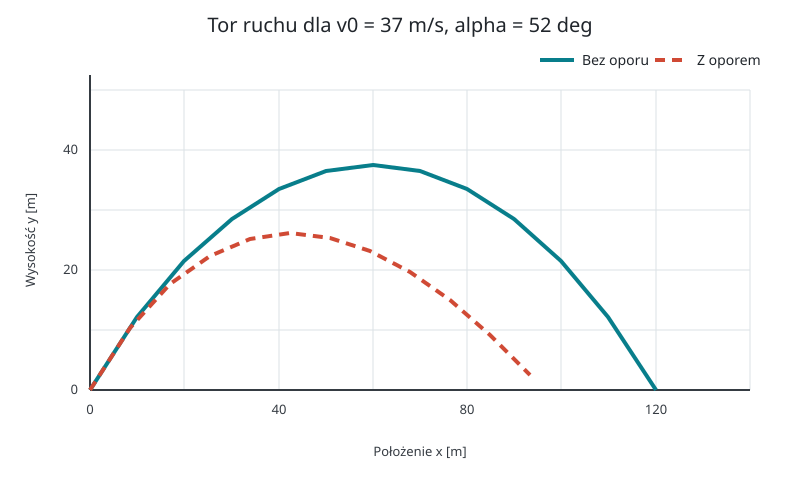
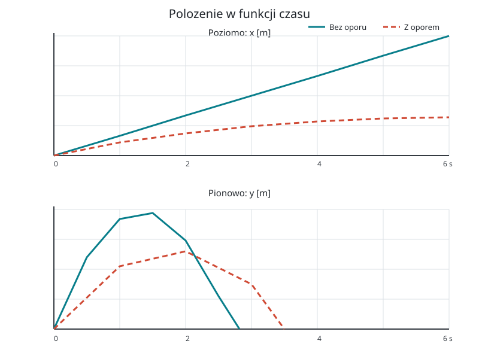
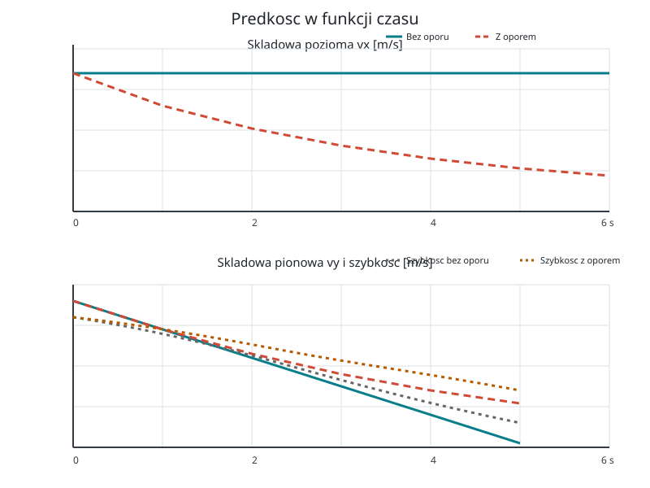
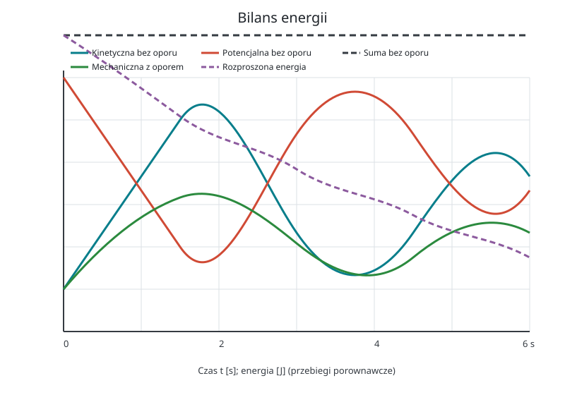
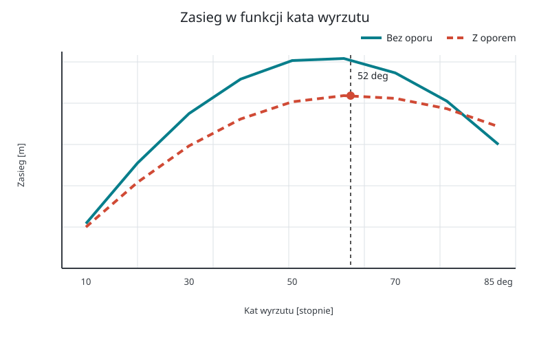

# Rzut ukośny bez oporu i z oporem powietrza

*Raport obliczeniowy: rozwiązanie analityczne, model aerodynamiczny i symulacja w Pythonie.*

**Temat:** ruch ciała rzuconego pod kątem do poziomu.  
**Metoda:** wyprowadzenie równań, porównanie rozwiązania idealnego z całkowaniem numerycznym oraz analiza wykresów.  
**Charakter danych:** wyniki symulacji modelowej, nie pomiar laboratoryjny.

Przyjmuję prędkość początkową $v_0=37\,\mathrm{m/s}$ i kąt początkowy $\alpha=52^\circ=0{,}9076\,\mathrm{rad}$. Są to odpowiednio dwie pierwsze i dwie ostatnie cyfry numeru indeksu. Kąt w równaniach trygonometrycznych i w programie zapisuję w radianach.

## Spis treści

1. [Cel i założenia](#1-cel-i-założenia)
2. [Rzut bez oporu powietrza](#2-rzut-bez-oporu-powietrza)
3. [Opór aerodynamiczny](#3-opór-aerodynamiczny)
4. [Wyniki i wykresy](#4-wyniki-i-wykresy)
5. [Metoda numeryczna i kod](#5-metoda-numeryczna-i-kod)
6. [Wnioski](#6-wnioski)

---

## 1. Cel i założenia

Rzut ukośny pozwala zobaczyć, jak ruch poziomy i pionowy składają się na jedną krzywoliniową trajektorię. Bez oporu powietrza przyspieszenie poziome jest zerowe, a pionowe stałe. Po uwzględnieniu oporu obie składowe prędkości wpływają na siłę hamującą, dlatego tor nie jest już parabolą.

Przyjmuję układ współrzędnych, w którym początek znajduje się w miejscu wyrzutu, oś $x$ jest pozioma, a oś $y$ skierowana pionowo w górę. Ciało startuje i ląduje na tej samej wysokości. Pomijam wiatr, wypór powietrza, obrót ciała i zmianę gęstości powietrza.

### Symbole i jednostki

| Symbol | Znaczenie | Jednostka SI |
| :--- | :--- | :---: |
| $x,y$ | położenie poziome i pionowe | $\mathrm{m}$ |
| $v_x,v_y,v$ | składowe prędkości i szybkość | $\mathrm{m/s}$ |
| $a_x,a_y,g$ | przyspieszenie i przyspieszenie grawitacyjne | $\mathrm{m/s^2}$ |
| $t,T$ | czas i czas lotu | $\mathrm{s}$ |
| $v_0$ | wartość prędkości początkowej | $\mathrm{m/s}$ |
| $\alpha$ | kąt wyrzutu | $\mathrm{rad}$ (lub stopnie przy podaniu danych) |
| $m$ | masa ciała | $\mathrm{kg}$ |
| $\rho$ | gęstość powietrza | $\mathrm{kg/m^3}$ |
| $C_D$ | bezwymiarowy współczynnik oporu | $1$ |
| $A$ | pole przekroju ciała | $\mathrm{m^2}$ |

We wszystkich obliczeniach używam $g=9{,}81\,\mathrm{m/s^2}$.

## 2. Rzut bez oporu powietrza

### 2.1. Rozkład prędkości początkowej

Prędkość początkową rozkładamy na składowe wzdłuż osi układu:

$$
v_{0x}=v_0\cos\alpha,\qquad v_{0y}=v_0\sin\alpha.
$$

Dla podanych danych $v_{0x}\approx22{,}78\,\mathrm{m/s}$ i $v_{0y}\approx29{,}16\,\mathrm{m/s}$. Z drugiej zasady Newtona, przy braku sił poziomych i działaniu ciężaru w pionie, wynika:

$$
a_x=0,\qquad a_y=-g.
$$

### 2.2. Wyprowadzenie równań ruchu

Korzystamy z definicji przyspieszenia $a=dv/dt$ i całkujemy po czasie. Przy warunkach początkowych $v_x(0)=v_{0x}$ oraz $v_y(0)=v_{0y}$ otrzymujemy:

$$
v_x(t)=v_0\cos\alpha,\qquad v_y(t)=v_0\sin\alpha-gt.
$$

Ponieważ $v=dx/dt$, ponowne całkowanie przy $x(0)=y(0)=0$ daje równania parametryczne toru:

$$
x(t)=v_0\cos\alpha\,t,
\qquad
y(t)=v_0\sin\alpha\,t-\frac{1}{2}gt^2.
$$

Eliminujemy czas z pierwszego równania, $t=x/(v_0\cos\alpha)$, i podstawiamy do drugiego:

$$
y(x)=x\tan\alpha-\frac{gx^2}{2v_0^2\cos^2\alpha}.
$$

Jest to równanie paraboli. Jej kształt wynika bezpośrednio ze stałej składowej pionowej przyspieszenia.

### 2.3. Czas lotu, zasięg i wysokość

W chwili lądowania $y(T)=0$. Po wyłączeniu $T$ przed nawias:

$$
0=T\left(v_0\sin\alpha-\frac{gT}{2}\right).
$$

Rozwiązanie $T=0$ odpowiada chwili wyrzutu; drugi pierwiastek jest czasem lotu:

$$
T=\frac{2v_0\sin\alpha}{g}\approx5{,}94\,\mathrm{s}.
$$

Podstawienie czasu lotu do $x(t)$ daje zasięg:

$$
R=v_0\cos\alpha\,T=\frac{v_0^2\sin(2\alpha)}{g}\approx135{,}4\,\mathrm{m}.
$$

Maksymalna wysokość występuje, gdy $v_y=0$. Stąd $t_H=v_0\sin\alpha/g$, a po podstawieniu do $y(t)$:

$$
H=\frac{v_0^2\sin^2\alpha}{2g}\approx43{,}3\,\mathrm{m}.
$$

Wyniki te zakładają równą wysokość startu i lądowania oraz brak oporu. W tym modelu zasięg dla ustalonego $v_0$ jest największy przy $\alpha=45^\circ$; nie należy przenosić tego wniosku automatycznie na ruch z oporem.

## 3. Opór aerodynamiczny

### 3.1. Model siły oporu

Dla szybko poruszającego się ciała przyjmuję kwadratowy model oporu:

$$
\vec{F}_D=-\frac{1}{2}\rho C_D A\,|\vec{v}|\,\vec{v}.
$$

Znak minus oznacza, że siła jest skierowana przeciwnie do prędkości. Współczynnik $C_D$ zależy m.in. od kształtu ciała i warunków przepływu. Dla przykładowego, gładkiego obiektu kulistego przyjmuję:

| Parametr | Wartość |
| :--- | ---: |
| masa $m$ | $0{,}145\,\mathrm{kg}$ |
| promień kuli $r$ | $0{,}0366\,\mathrm{m}$ |
| pole przekroju $A=\pi r^2$ | $0{,}00421\,\mathrm{m^2}$ |
| gęstość powietrza $\rho$ | $1{,}225\,\mathrm{kg/m^3}$ |
| współczynnik oporu $C_D$ | $0{,}47$ |

To uproszczone parametry obiektu modelowego; nie opisują dokładnie każdej piłki ani rzeczywistych warunków atmosferycznych.

### 3.2. Równania ruchu z oporem

Druga zasada Newtona ma postać $m\vec{a}=m\vec{g}+\vec{F}_D$. Dla $v=\sqrt{v_x^2+v_y^2}$ rozpisujemy ją na osie:

$$
\frac{dx}{dt}=v_x,\qquad \frac{dy}{dt}=v_y,
$$

$$
\frac{dv_x}{dt}=-\frac{\rho C_D A}{2m}v v_x,
\qquad
\frac{dv_y}{dt}=-g-\frac{\rho C_D A}{2m}v v_y.
$$

Przyspieszenie zależy teraz od prędkości, więc nie jest stałe. Układ jest sprzężony: zmiana którejkolwiek składowej wpływa na szybkość $v$, a przez nią na obie składowe siły oporu. Dla tych równań nie otrzymujemy prostej parabolicznej trajektorii.

Moc siły oporu jest równa $P_D=\vec{F}_D\cdot\vec{v}=-\tfrac12\rho C_DA v^3\leq0$. Opór odbiera energię mechaniczną i zamienia ją głównie w energię wewnętrzną powietrza oraz ciała.

## 4. Wyniki i wykresy

Pierwsze cztery wykresy porównują ruch dla tych samych warunków początkowych: $v_0=37\,\mathrm{m/s}$ i $\alpha=52^\circ$. Linia przerywana lub pełna jest opisana w legendzie każdego wykresu. Wartości po uwzględnieniu oporu są wynikiem całkowania numerycznego dla parametrów z tabeli powyżej.



*Rysunek 1. Tor w modelu idealnym jest parabolą. Opór zmniejsza zasięg i wysokość oraz czyni tor niesymetrycznym względem jego wierzchołka.*



*Rysunek 2. Składowa pozioma położenia z oporem nie rośnie liniowo, ponieważ prędkość pozioma maleje. Krzywa pionowa pokazuje zmianę wysokości i moment powrotu do podłoża.*



*Rysunek 3. Bez oporu $v_x$ jest stałe, a $v_y$ zmienia się liniowo. W modelu aerodynamicznym obie składowe są zmienne; podczas opadania składowa pionowa może osiągnąć prędkość graniczną.*



*Rysunek 4. Bez oporu suma energii kinetycznej i potencjalnej jest stała. Z oporem energia mechaniczna maleje; całka z mocy oporu pokazuje energię rozproszoną.*



*Rysunek 5. Zasięg obliczony dla zakresu kątów. W modelu z oporem kąt maksymalnego zasięgu jest mniejszy niż $45^\circ$. Znacznik wskazuje kąt $52^\circ$ użyty w pozostałych wykresach.*

> [!NOTE]
> Wartości zasięgu i wysokości dla modelu z oporem są drukowane przez skrypt. Zależą od przyjętych $m$, $C_D$, $A$, $\rho$ oraz kroku całkowania; nie są uniwersalnymi stałymi rzutu ukośnego.

## 5. Metoda numeryczna i kod

Równania z oporem zapisuję jako układ pierwszego rzędu dla wektora stanu $\mathbf{s}=(x,y,v_x,v_y)$. Krok metody Rungego–Kutty czwartego rzędu (RK4) przybliża rozwiązanie z użyciem czterech ocen pochodnej:

$$
\mathbf{s}_{n+1}=\mathbf{s}_n+\frac{\Delta t}{6}(\mathbf{k}_1+2\mathbf{k}_2+2\mathbf{k}_3+\mathbf{k}_4),
$$

$$
\mathbf{k}_1=f(\mathbf{s}_n),\quad
\mathbf{k}_2=f\left(\mathbf{s}_n+\frac{\Delta t}{2}\mathbf{k}_1\right),\quad
\mathbf{k}_3=f\left(\mathbf{s}_n+\frac{\Delta t}{2}\mathbf{k}_2\right),\quad
\mathbf{k}_4=f(\mathbf{s}_n+\Delta t\mathbf{k}_3).
$$

Wykresy generuje [skrypt `generuj_wykresy.py`](generuj_wykresy.py). Kluczowa część modelu siły i pojedynczego kroku wygląda tak:

```python
def pochodna(stan):
	x, y, vx, vy = stan
	szybkosc = np.hypot(vx, vy)
	wspolczynnik = 0.5 * gestosc * Cd * pole / masa * szybkosc
	return np.array([
		vx,
		vy,
		-wspolczynnik * vx,
		-g - wspolczynnik * vy,
	])


def krok_rk4(stan, dt):
	k1 = pochodna(stan)
	k2 = pochodna(stan + 0.5 * dt * k1)
	k3 = pochodna(stan + 0.5 * dt * k2)
	k4 = pochodna(stan + dt * k3)
	return stan + (dt / 6) * (k1 + 2*k2 + 2*k3 + k4)
```

Krok czasu w skrypcie wynosi $\Delta t=0{,}005\,\mathrm{s}$. Integrację kończę po powrocie ciała do wysokości początkowej; ostatni punkt interpoluję do $y=0$. Po uruchomieniu z folderu raportu polecenie `python generuj_wykresy.py` zapisuje obrazy w `files/rzut_ukosny/`. Wymagane pakiety: `numpy` i `matplotlib`.

## 6. Wnioski

- Bez oporu ruch poziomy jest jednostajny, a pionowy jednostajnie przyspieszony. Ich połączenie daje parabolę.
- Dla $v_0=37\,\mathrm{m/s}$ i $\alpha=52^\circ$ model idealny przewiduje czas lotu około $5{,}94\,\mathrm{s}$, zasięg około $135{,}4\,\mathrm{m}$ i maksymalną wysokość około $43{,}3\,\mathrm{m}$.
- Opór aerodynamiczny zmniejsza składowe prędkości i energię mechaniczną, a przez to zmienia czas lotu, wysokość oraz zasięg. Trajektoria przestaje być parabolą.
- Model z oporem jest wrażliwy na parametry ciała i powietrza. Wynik należy więc interpretować razem z przyjętymi założeniami, a nie jako dokładną prognozę dla dowolnego obiektu.
